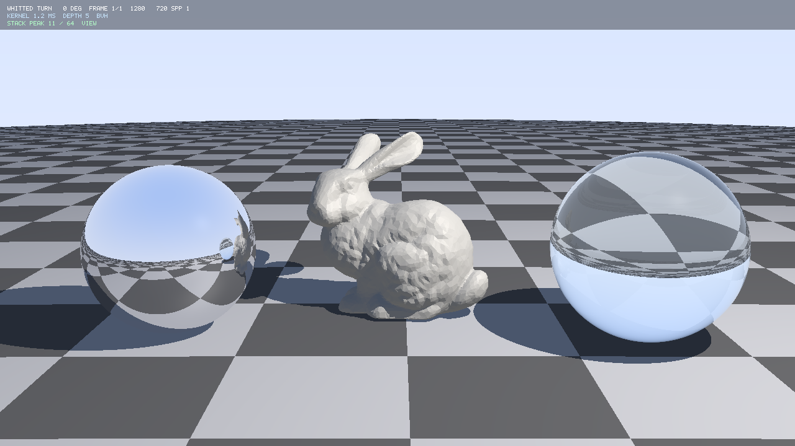
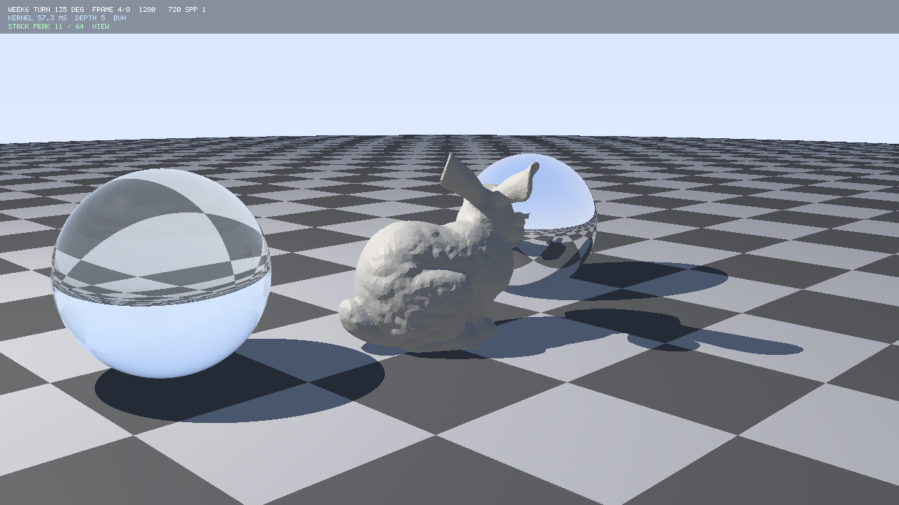
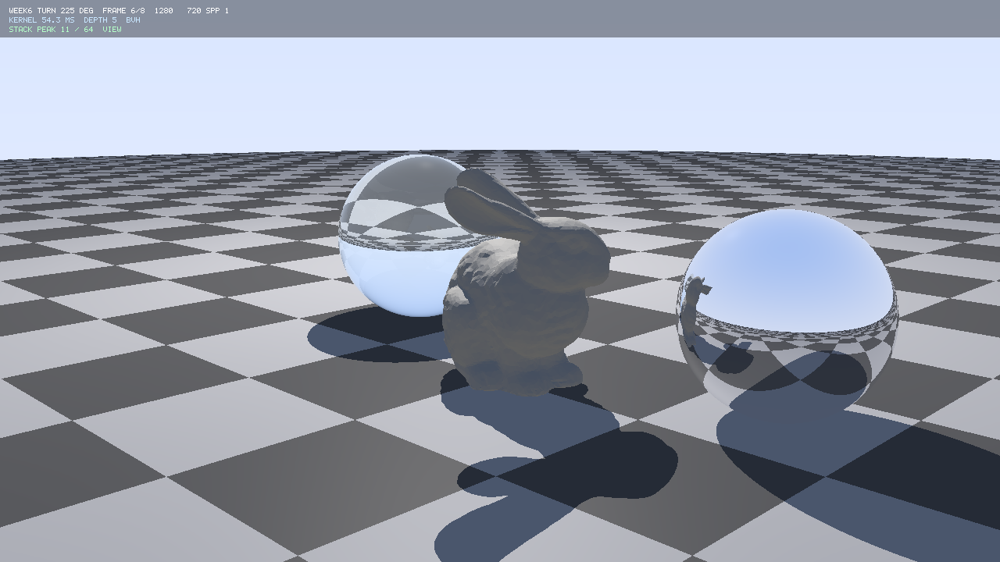
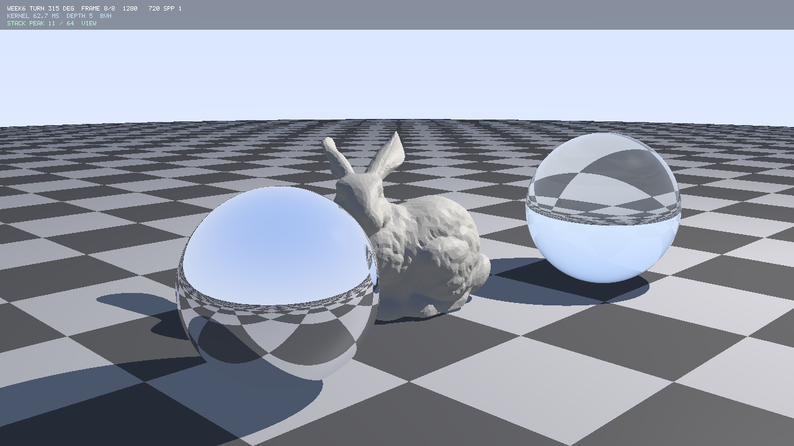
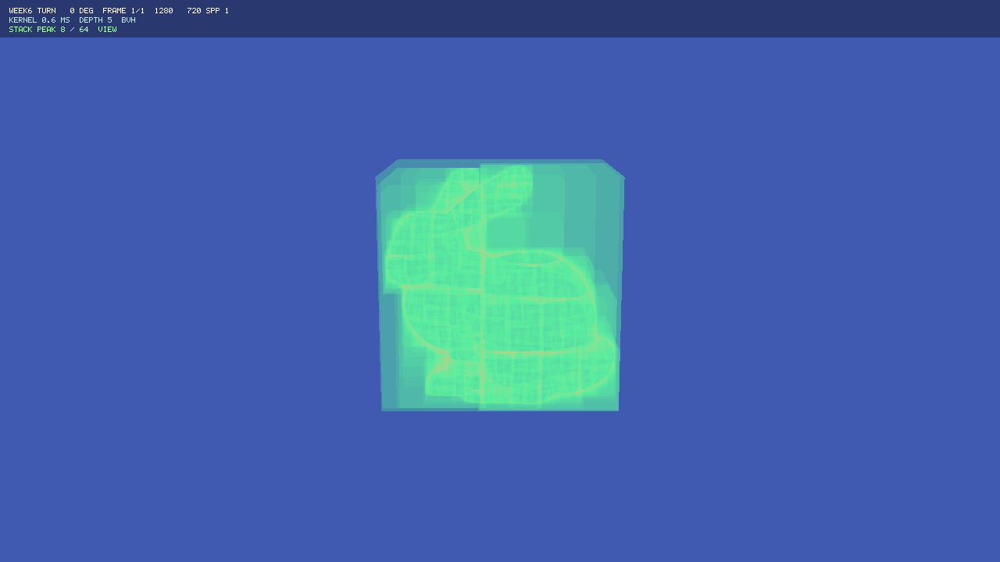
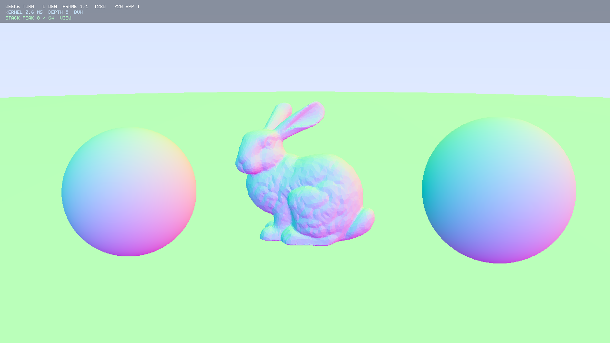
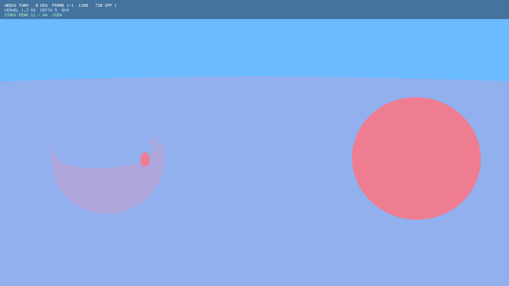
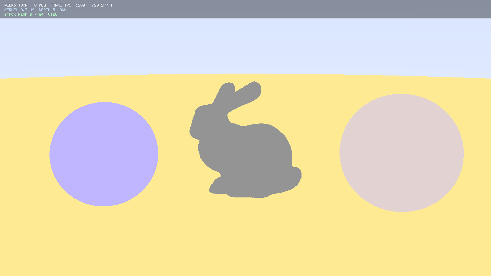

# CUDA Whitted 光线追踪器

用 CUDA 实现的 Whitted 风格光线追踪器：递归反射/折射、Schlick Fresnel、硬阴影、
OBJ 三角网格（assimp 加载）、BVH 加速，以及一套**逐档量化**的优化对比。

**核心数据**（Release x64 / 2560×1440 / 10000 面 Bunny / 6 次中位数）：

| 指标 | 数值 |
| --- | --- |
| 暴力遍历（无 BVH） | 1305.58 ms |
| **BVH 最优档** | **3.78 ms** |
| **加速比** | **345×** |
| 逐像素一致性 | 371 万像素中仅 **1 个**像素差 15 色阶（浮点并列取舍） |
| 建树耗时 | 8.02 ms（一次建树、多帧复用，4 个 BVH 档共用） |

---

## 1. 快速开始

### 1.1 用 Visual Studio（最省事）

1. 打开仓库根目录的 `whitted.slnx`；
2. 配置选 **Release** + **x64**（Debug 也能跑，只是慢很多）；
3. **不需要加 `/utf-8`**：源文件已经是 UTF-8 带 BOM，编码问题由 BOM 解决（见 1.3）；
4. `F5` 运行。**不带参数时默认输出 8 张绕 Y 轴的转台图**（`src\out\*_turn00..turn07.png`），
   想要单张就加 `--frames 1`（命令行参数见第 2 节）。

### 1.2 命令行编译

```bat
call "C:\Program Files\Microsoft Visual Studio\18\Community\VC\Auxiliary\Build\vcvars64.bat"
cd /d <仓库根>\whitted
nvcc -std=c++17 -O2 -arch=native kernel.cu -o whitted.exe
whitted.exe --frames 1
```

- `-arch=native` 会针对本机 GPU 生成代码（本机是 RTX 4070 Ti / `sm_89`）；
  想固定架构就写 `-arch=sm_89`。
- `-std=c++17` 是保险起见；代码实际只用到 C++11/14 的特性（`std::nth_element`、`alignas`、
  模板），但如果工具链默认标准更老，显式指定更稳。
- **注意命令行里没有 `-Xcompiler /utf-8`**：编码靠文件里的 BOM，不靠开关。

### 1.3 编码：源文件是 UTF-8 带 BOM，不需要 `/utf-8`

> 早期版本这里写的是「必须加 `/utf-8`」，那是基于「无 BOM」的旧状态；**现在已废弃**。

源码注释与打印字符串都是中文。如果文件是 **UTF-8 无 BOM**，中文 locale 的 nvcc 会按代码页
936(GBK) 解码，出现 `warning C4819`、报一个**根本不存在的**
`fatal error C1070: #if/#endif 不匹配`，或者更常见的 `missing closing quote`
（中文的 trail byte 把字符串结尾的引号吃掉了）。

**本仓库的处理：所有 `.cu/.h` 统一为 UTF-8 带 BOM（`EF BB BF`）。**
BOM 是 cl 与 nvcc 前端都能识别的 in-file 信号，两个编译器都会据此按 UTF-8 解码，
所以**一个编码相关的编译选项都不用加**。

本机实际配置（真实核对，不是建议值）：

| 位置 | 实际值 |
| --- | --- |
| CUDA C/C++ → Command Line → 其它选项 | `-Xcompiler "/Zc:preprocessor" --extended-lambda` |
| C/C++ → 命令行 → 其它选项 | （空） |
| CUDA C/C++ → Host → Additional Compiler Options | （空） |

**为什么不用 `/utf-8`**：`-Xcompiler /utf-8` 只转发给主机编译器 cl，
而 `.cu` 的预处理与字符串解析发生在 nvcc 自己的前端，那里读不到这个开关。

**维护提醒**：AI 编辑工具每次改文件会剥掉 BOM，改完要重跑
`powershell -ExecutionPolicy Bypass -File .\_tools\add_bom.ps1`（幂等，会先备份）。

程序内部还做了一层保险：启动时探测自己的中文字符串是 UTF-8 还是 GBK 字节，
只有在确实是 UTF-8 时才 `SetConsoleOutputCP(CP_UTF8)`，避免控制台乱码。
### 1.4 第三方依赖：assimp

本仓库提交了 assimp 的**头文件与导入库**（`_third_party/assimp/`），所以**编译能过**；
但 **14 MB 的运行时 DLL 没有入库**（`.gitignore` 排除了 `*.dll`）。

**你需要做**：

1. 从 [assimp 官方 releases](https://github.com/assimp/assimp/releases) 下载 Windows 构建，或自行 CMake 编译；
2. 把 `assimp-vc142-mtd.dll` 复制到 **exe 同目录**（`x64\Release\` 或 `x64\Debug\`）；
3. **没有 DLL 也不会崩** —— 程序会打印 `[assimp] 未启用或失败（...）`，
   自动回退到手写 OBJ 解析器，功能完整只是加载慢一点。

**为什么是 `mtd`（`/MTd`）版本**：assimp 官方 Windows 预编译包提供的是 Debug 静态 CRT 版本。
实测它与本项目的 `/MDd`（Debug）、`/MD`（Release）**都能共存**，不需要改运行库设置。

**VS 项目配置**（已经配好，clone 后无需改动）：

| 配置项 | 值 |
| --- | --- |
| VC++ 目录 → 包含目录 | `..\_third_party\assimp\include` |
| VC++ 目录 → 库目录 | `..\_third_party\assimp\lib` |
| 链接器 → 附加依赖项 | `assimp-vc142-mtd.lib` |
| CUDA C/C++ → Common → Additional Include Directories | `..\_third_party\assimp\include`（**别漏，nvcc 前端要用**） |

---


---

## 2. 命令行参数

| 参数 | 默认 | 说明 |
| --- | --- | --- |
| `--width N` / `--height N` | 1280 / 720 | 渲染分辨率 |
| `--spp N` | 1 | 每像素采样数（>1 时做抖动抗锯齿），上限 64 |
| `--depth N` | 5 | 最大递归深度（夹到 1~16；再深寄存器压力会明显上升） |
| `--fov DEG` | 场景常量 `CAM_FOV` | 相机竖直视场角 |
| `--obj PATH` | `..\objs\bunny_10k.obj` | 加载 OBJ 模型（默认即仓库自带的斯坦福兔子：5,002 顶点 / **10,000 面**）；解析 `f` 的 `a`、`a/b`、`a//b`、`a/b/c` 四种写法与负下标，`vt/vn` 只跳过不报错。路径相对**项目目录**解析（VS 调试的工作目录就是 `whitted\src\`），加载失败会自动回退到程序化网格 |
| `--frames N` | 8 | 绕 Y 轴等角度转台，输出 N 张图（默认 `turn00`…`turn07`）；`--frames 1` = 单张（角度 0） |
| `--bench` | 关 | **5 档性能对比 + 逐像素校验**（默认 640x360，可用 `--width/--height` 调大）；会额外存 `bench0_brute` 与 `bench4_best` 两张图 |
| `--mode brute\|bvh` | bvh | 强制走暴力遍历或 BVH 遍历 |
| `--split mid\|sah` | mid | BVH 分割方式：最大轴中位质心 / 12 候选 SAH |
| `--debug shaded\|normals\|depth\|hits\|heatmap` | shaded | 调试视图；`heatmap` 把**主光线访问过的 BVH 节点数**画成热力图（不是三角形求交次数） |
| `--interactive` | 关 | 打开 Win32 实时预览窗口（低分辨率 + 方向键/WASD 移动相机；不加这个参数不会创建窗口） |
| `--out DIR` / `--tag NAME` | `out` / 空 | 输出目录 / **标签前缀**：最终文件名里的标签是 `<NAME>_<内置标签>`（例如 `--tag probe` + 转台会得到 `probe_turn03`） |
| `--ppm-only` / `--png-only` | 两个都写 | 只写 PPM（最快）/ 只写 PNG |
| `--help` | — | 打印全部参数与默认值后退出 |

输出文件名格式：`whitted_<宽>x<高>spp<采样>[_标签].ppm|png`，其中标签可能是
`<你给的 tag>_<内置标签>`（内置标签如 `turn00`、`bench0_brute`）。

---

## 3. 目录结构

```
whitted\                         仓库根
  .gitignore
  README.md                      本文件
  whitted.slnx                   解决方案（指向 src/whitted.vcxproj）
  objs\
    bunny_10k.obj                斯坦福兔子，5,002 顶点 / 10,000 面（--obj 默认值）
  _third_party\
    assimp\
      include\                   assimp 头文件（68 个 .h + 8 个 .inl + 9 个 .hpp）
      lib\assimp-vc142-mtd.lib   导入库（366 KB）
      assimp.props               可选属性表（一次配好包含/库路径）
    stb\
      stb_image_write.h          PNG 输出（71 KB，header-only）
  src\                           项目目录（.vcxproj 所在）
    whitted.vcxproj
    kernel.cu                    唯一 CUDA 编译单元：main + kernel + 场景 + 自检 + bench + 转台
    bvh.h                        AABB/slab 求交、CPU 建树（中点 / SAH）、GPU 显式栈有序遍历
    triangle.h                   AoS + SoA 两套三角形布局、Möller–Trumbore
    obj_loader.h                 OBJ 解析 + 程序化兜底网格 + 变换
    obj_assimp.cpp               assimp 加载实现（普通 C++ 单元，不经过 nvcc）
    empty.cpp                    空占位（让「C/C++」页属性有消费者）
    materials.h                  漫反射 / 镜面 / 玻璃材质 + Blinn-Phong + 阴影
    sphere.h                     球体求交（地面 / 镜面球 / 玻璃球）
    interactive.h                Win32 实时预览（GDI，无需 OpenGL）
    vec3.h rt_math.h rt_print.h cuda_check.h image_io.h png_writer.h font5x7.h
                                 基础头文件本地副本 —— 本工程**自包含**
    out\                         出图（PNG）与报告
      perf_report.md             完整性能报告（已填实测数据）
      raw_bench_data.md          6 次原始读数 + 统计
      technical_notes.md         六个核心技术问答
```

**编译单元共 3 个**：

| 文件 | 编译器 | 作用 |
| --- | --- | --- |
| `kernel.cu` | **nvcc** | CUDA 代码（kernel + host 逻辑） |
| `empty.cpp` | cl.exe | **无代码**，只为了让「C/C++」页属性（运行库等）有消费者 |
| `obj_assimp.cpp` | cl.exe | assimp 加载器实现，**nvcc 看不到 assimp 头**（避免 device pass 解析几万行模板） |

模型路径是 **相对项目目录**写的（`..\objs\bunny_10k.obj`），因为 Visual Studio 调试时的
工作目录就是 `whitted\src\`。从别的工作目录启动 exe 时，要么 `cd` 到 `whitted\src\`，
要么用 `--obj` 给绝对路径。**看不到 `[assimp] 5.0.0 加载成功（10000 三角形）` 就说明路径错了。**
---

## 4. 性能对比（`--bench` 的 5 档）

`whitted.exe --bench` 会依次跑下面 5 档，**每档都与档 0（暴力基准）做逐像素比对**，
并打印耗时与加速比。5 档共用同一棵树（只建一次），所以建树耗时那一列 5 行相同。

| 档 | 配置 | 相对上一档只改了 | 渲染(ms) | 加速比 | 逐像素最大差 |
| --- | --- | --- | --- | --- | --- |
| **0** 基线 | 暴力遍历（AoS 三角形，无 BVH） | — | **1305.58** | 1.0× | 基准 |
| **1** | BVH 32B 节点 + AoS + **无序遍历** | 加 BVH（固定先左后右） | **3.98** | **328.4×** | maxDiff 15（1 像素） |
| **2** | BVH 32B + AoS + **有序遍历** | 只改遍历顺序 | **3.78** | **345.4×** | **0** |
| **3** | + 三角形 **SoA** 访存 | 只改三角形布局 | **4.24** | **308.3×** | **0** |
| **4** | + **共享内存**缓存根节点 | 只改节点访存层次 | **4.78** | **273.1×** | **0** |

**三项优化的收益就是相邻两档相除**（每对之间只差一个编译期开关，归因是干净的）：

| 优化项 | 公式 | 说明 |
| --- | --- | --- |
| **有序遍历 + 剪枝** | 档 1 ÷ 档 2 | 近子节点优先，先命中近处 → `best` 立刻变小 → 远处子树整棵被剪掉 |
| **三角形 SoA** | 档 2 ÷ 档 3 | 可能 <1（见下） |
| **共享内存根缓存** | 档 3 ÷ 档 4 | 根附近 16 个节点进 `__shared__` |
| **BVH 整体** | 档 0 ÷ 档 4 | 简历上那个总加速比 |

**程序不会自己写 `out\perf_report.md`** —— 它只把数据打印到控制台，并额外存下
`bench0_brute` 与 `bench4_best` 两张图便于肉眼对比；`out\perf_report.md` 是**手写模板**，
跑完 `--bench` 之后照着控制台把数字填进去。

三项优化的原理：

1. **有序遍历 + `best` 剪枝**：先用当前最近距离 `best` 测两个孩子盒子的**入口距离 t**，
   近的先走、远的压栈；退栈时若该节点入口距离已 `>= best`，整棵子树直接丢掉。
   这是三项里**收益最大**的一项（10k 面兔子上通常 1.5~3 倍）。
   档 1 与档 2 的差别在 `traverseBvh()` 里就是一行 `Ordered ? (tLeft <= tRight) : true`。
2. **三角形 SoA 布局**：Möller–Trumbore 要连续读 `v0/v1/v2` 的 9 个 float；SoA 让同一 warp
   内不同三角形的同一分量落在连续地址上，访存更容易合并。
   **注意这一项可能变慢**：SoA 把「一次 40 字节连续读」拆成 10 次分散标量读，
   只有在 warp 内线程命中同一批叶子三角形时才划算。表里是快是慢都照实写。
3. **共享内存缓存根节点**：BVH 顶部若干层是每个 warp 都要反复访问的热点，把根附近 16 个节点
   搬进 `__shared__`，省掉全局访存。4070 Ti 的 L1 本来就能兜住这一小段，收益通常很小。

> **节点 32 字节对齐不是本项目的优化项** —— 更早的版本里就已经做了
> （`BvhNode` = `bmin[3] + leftOrTriStart` / `bmax[3] + count` 两个 16 字节块，
> 带 `static_assert(sizeof == 32)` 钉死），这里它属于**基线**。
> 代码里还留着一个 40 字节的 `BvhNodeNaive`，但只用于展示对齐前后的显存差别，**不在 bench 的 5 档里**。
>
> 本项目把 BVH 优化拆成 5 档逐项量化，而不是「打包改完只报一个总加速比」——

> 档 1~4 之间只改访存布局与遍历顺序、**不改数学**，所以它们彼此的 `maxDiff` **必须全为 0**；
> 与档 0 的差异则可能非 0（两个三角形到光线距离在浮点上并列时，谁先被访问不同），
> 程序会打印实测值，**不要**把它当 0 报出去。

---

## 5. 截图

所有图都是 `whitted.exe` 直接输出的 PNG，参数标注在每张图下方。

### 5.1 主图


> `1280×720`、spp 1、递归深度 5。10000 面 Bunny（assimp 加载）
> + 镜面球（反射棋盘与兔子）+ 玻璃球（折射，ior 1.50）+ 棋盘地面。

### 5.2 转台（`--frames 8`）

| 0° | 90° | 180° | 270° |
| --- | --- | --- | --- |
|  |  |  |  |

> 相机绕 Y 轴等角度旋转，其余参数不变。用来验证 BVH 在不同视角下都正确。

### 5.3 调试视图

| 视图 | 图 | 说明 |
| --- | --- | --- |
| **heatmap** |  | **每像素访问的 BVH 节点数**（对数刻度）。越亮访问越多。用它定位「哪些像素的遍历代价高」，是优化前必看的一张图。 |
| **normals** |  | 法线方向（RGB 编码 xyz）。用来验证求交与法线朝向：球面平滑过渡、地面朝上（偏绿）、兔子表面法线连续。 |
| **depth** |  | 递归深度。**天空=0、漫反射表面=1**、镜面球=2、玻璃球=5（多次折射）。越深越偏红。 |
| **hits** |  | 物体编号（每个物体一种颜色）。用来验证 BVH 没有漏三角形。 |

> **depth 视图曾经有个 bug**：早期实现里 `depthReached` 用 `depth > *depthReached` 更新，
> 主光线（depth=0）打中漫反射时 `0 > 0` 为假、不更新，导致「天空」和「兔子/地面」都是 0，
> 深度图里同色、看不出兔子轮廓。修复方式是把更新条件改成 `depth + 1 > *depthReached`，
> 并把归一化分母同步改成 `maxDepth + 1`。现在天空(0) 与漫反射表面(1) 已经能区分开。

### 5.4 暴力 vs BVH 对照

| 暴力（档 0） | BVH 最优（档 4） |
| --- | --- |
|  |  |

> 两张图**逐像素一致**（maxDiff = 0），但渲染时间相差 **273×**（1305.58 ms → 4.78 ms）。
> 这是 BVH 加速最直观的证据：画面不变、速度提升两个数量级。

---

## 6. 已知限制

- 场景图元只有**球和三角形**，没有平面/圆锥等，地面是「半径 1000 的大球」充当平面。
- 阴影是**硬阴影**（单点光源），没有面光源软阴影；没有环境光遮蔽。
- 没有纹理贴图（hit record 只有 `t / point / normal / materialId` 四个字段，没有 UV 参数，
  所以连预留接口都还没有）；地面棋盘是程序化按世界坐标算的。
- 材质是 Whitted 式的「直接光 + 镜面反射 + 折射」，**不是**路径追踪：没有多次漫反射弹射、
  没有重要性采样，所以焦散、颜色渗透这类效果不会出现。
- 递归深度夹在 1~16（默认 5），这是寄存器压力与栈深度的折中；更深的反射链会被截断成极暗环境色。
- 浮点精度：`float` 计算，掠射角与共面几何处用 `RT_SHADOW_EPS` 偏移规避自交。
- 交互预览用的是 GDI（`StretchDIBits`），不是 OpenGL Interop；分辨率低、只适合调相机。

---

## 7. 故障排查

| 现象 | 原因 / 处理 |
| --- | --- |
| 报 `C1070: #if/#endif 不匹配` 或 `missing closing quote` | 编码问题：**BOM 被剥掉了**。跑 `_tools\add_bom.ps1` 补回（见 1.3），**不是代码有语法错误** |
| 控制台中文乱码 | 同上；或确认 `setupConsoleEncoding()` 的探针是否生效 |
| 只写出 `.ppm` 没有 `.png` | 找不到 `stb_image_write.h`：**本仓库已经自带** `_third_party\stb\stb_image_write.h`（`png_writer.h` 会按 `../_third_party/stb/` 查找）。若仍报这个错，检查该文件是否被误删 |
| 运行即崩 / 全黑 | 先看 `--mode brute` 是否正常（能出图说明是 BVH 侧的问题）；BVH 模式下看控制台打印的「栈峰值 / 溢出次数」：溢出只会**计数并告警**，程序**不会**自动退回线性扫描（那样会破坏各档之间的一致性），所以溢出非 0 时画面可能出现空洞，需要调 `--split` 或叶子阈值 |
| 图能出但物体不在画面里 | `--debug normals` 先确认几何，再调 `--fov` 或场景常量 |
